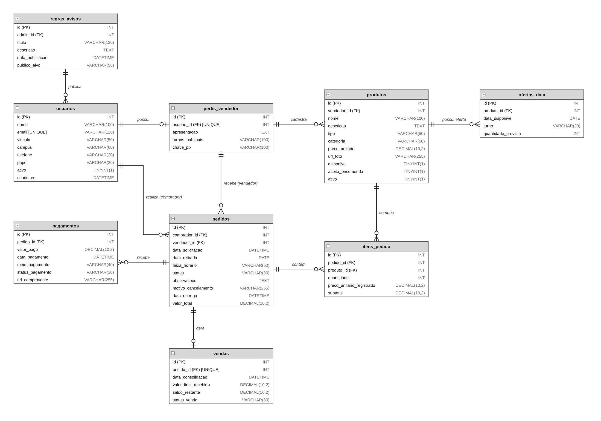

# INSTITUTO FEDERAL
Rio de Janeiro — Campus Niterói  
**CURSO DE BACHARELADO EM ENGENHARIA DA COMPUTAÇÃO**  
**BANCO DE DADOS II**

---

# DOCUMENTAÇÃO TÉCNICA DO PROJETO INTEGRADOR DE BDI
**Cantina Solidária (Sistema de Vendas e Encomendas Universitário)**

| Identificação | Informação |
| :--- | :--- |
| **Equipe** | Equipe Cão |
| **Integrantes** | Gabriel de Oliveira Pires , Cauê Augusto da Silva Valença de Souza , Marcelo Silva de Oliveira  |
| **Tema/contexto** | Cantina Solidária — Plataforma de Vendas e Encomendas no Campus |
| **Repositório GitHub** | https://github.com/Marc3lin-facul/Projeto_Solucao_Dados_CantinaSolidaria |
| **SGBD relacional e ambiente** | MySQL Community Server 8.0.46 (Ambiente Local — Windows) |
| **SGBD NoSQL e ambiente** | [Preencher na APD6] |
| **Ferramentas analíticas/ETL** | [Preencher na APD7] |

### CONTROLE DE VERSÕES DA DOCUMENTAÇÃO

| Versão | Data | APD | Responsável (is) | Principais alterações |
| :--- | :--- | :--- | :--- | :--- |
| 1.0 | 17/11/2026 | APD1 | Marcelo | Estruturação inicial da documentação, modelo lógico relacional, scripts DDL, DML, DQL (consultas e subconsultas) e evidências. |
| 1.1 | 17/11/2026 | APD2 | Cauê] | Inclusão da seção de programação procedural (3 Procedures, 3 Functions e 3 Triggers), scripts e evidências de execução. |
| 1.2 | 17/11/2026 | APD3 | Gabriel | Inclusão das políticas de administração, segurança e integridade (criação de papéis, usuários, privilégios GRANT/REVOKE e testes). |
| [Preencher] | [Preencher] | [Preencher] | [Preencher] | [Preencher] |
| [Preencher] | [Preencher] | [Preencher] | [Preencher] | [Preencher] |

---

## 1. CONTEXTO E OBJETIVO DA SOLUÇÃO (APD1)

### 1.1 Contexto do problema e demanda tecnológica
No ambiente acadêmico do IFRJ (Campus Niterói e demais campi), estudantes e servidores comercializam alimentos e bebidas de forma informal para complementar renda, enfrentando dificuldades na divulgação de cardápios por turno, organização de encomendas, controle de disponibilidade por data e acompanhamento de pagamentos (especialmente via PIX).

O objetivo desta base de dados relacional (`db_vendas_campus`) é centralizar e estruturar o armazenamento das informações operacionais da plataforma **Cantina Solidária**, permitindo o cadastro de usuários, perfis de vendedores, produtos, ofertas agendadas por data/turno, pedidos, itens de pedido, pagamentos, consolidação de vendas e comunicados administrativos. A base possibilita a realização de consultas gerenciais, relatórios de faturamento por vendedor/categoria e validações de integridade, atendendo a três perfis de usuários: **Administradores**, **Vendedores** e **Compradores**.

### 1.3 Principais requisitos e regras de negócio

| ID | Requisito / regra de negócio | Tabelas/recursos relacionados |
| :--- | :--- | :--- |
| RN01 | Todo usuário deve possuir um e-mail único cadastrado e um papel definido no sistema (`comprador`, `vendedor` ou `admin`). | `USUARIOS` (`email UNIQUE`, `papel`) |
| RN02 | Um usuário com perfil de vendedor deve possuir exatamente um perfil de vendedor associado com sua chave PIX e turnos habituais. | `PERFIS_VENDEDOR` (`usuario_id UNIQUE`, `chave_pix`) |
| RN03 | Cada produto pertence a um vendedor, possui preço unitário positivo e indica se está disponível e se aceita encomenda. | `PRODUTOS`, `sp_cadastrar_produto` |
| RN04 | Produtos podem ter ofertas programadas para datas e turnos específicos com quantidade prevista definida. | `OFERTAS_DATA` (`produto_id`, `data_disponivel`, `turno`) |
| RN05 | Um pedido vincula um comprador a um vendedor, contendo itens registrados com o preço unitário vigente no momento da compra e subtotal calculado automaticamente. | `PEDIDOS`, `ITENS_PEDIDO`, `trg_before_insert_item_pedido`, `trg_after_insert_item_pedido` |
| RN06 | Pedidos já entregues não podem ser cancelados; produtos vinculados a pedidos não podem ser excluídos fisicamente do banco. | `PEDIDOS`, `PRODUTOS`, `sp_cancelar_pedido`, `trg_before_delete_produto` |
| RN07 | Cada pedido consolidado gera um único registro de venda contendo o valor final recebido e eventual saldo restante. | `PAGAMENTOS`, `VENDAS` (`pedido_id UNIQUE`), `sp_consolidar_venda` |
| RN08 | Administradores publicam regras e avisos direcionados ao público-alvo (`Todos`, `Vendedores` ou `Compradores`). | `REGRAS_AVISOS` (`admin_id`) |

---

## 2. APD1 - BASE DE DADOS RELACIONAL: MODELOS E IMPLEMENTAÇÃO

### 2.1 SGBD, ferramentas e ambiente

| Item | Descrição |
| :--- | :--- |
| **SGBD / versão** | MySQL Community Server 8.0.46 |
| **Ambiente (local/nuvem)** | Ambiente Local (Windows — `localhost:3306`) |
| **Ferramentas utilizadas** | MySQL Workbench, Git e GitHub |
| **Orientações para acesso/verificação pelo professor (sem credenciais)** | Clonar o repositório público no GitHub e executar os scripts SQL na ordem numérica (`01` a `07`) em uma instância MySQL 8.0+ utilizando o MySQL Workbench. |

### 2.2 Modelo lógico/relacional

### 2.4 Relacionamentos e integridade referencial

| Tabela / FK | Tabela / PK referenciada | Regra / restrição |
| :--- | :--- | :--- |
| `PERFIS_VENDEDOR` / `fk_perfil_usuario` (`usuario_id`) | `USUARIOS` / `id` | Chave Estrangeira com restrição `UNIQUE` (relacionamento 1:1); exclusão/atualização restrita (`RESTRICT`). |
| `PRODUTOS` / `fk_produto_vendedor` (`vendedor_id`) | `PERFIS_VENDEDOR` / `id` | Chave Estrangeira (1:N); exclusão/atualização restrita (`RESTRICT`). |
| `OFERTAS_DATA` / `fk_oferta_produto` (`produto_id`) | `PRODUTOS` / `id` | Chave Estrangeira (1:N); exclusão/atualização restrita (`RESTRICT`). |
| `PEDIDOS` / `fk_pedido_comprador` (`comprador_id`) | `USUARIOS` / `id` | Chave Estrangeira (1:N); exclusão/atualização restrita (`RESTRICT`). |
| `PEDIDOS` / `fk_pedido_vendedor` (`vendedor_id`) | `PERFIS_VENDEDOR` / `id` | Chave Estrangeira (1:N); exclusão/atualização restrita (`RESTRICT`). |
| `ITENS_PEDIDO` / `fk_item_pedido` (`pedido_id`) | `PEDIDOS` / `id` | Chave Estrangeira (1:N); exclusão/atualização restrita (`RESTRICT`). |
| `ITENS_PEDIDO` / `fk_item_produto` (`produto_id`) | `PRODUTOS` / `id` | Chave Estrangeira (1:N); exclusão restrita (`RESTRICT`) reforçada por trigger `BEFORE DELETE`. |
| `PAGAMENTOS` / `fk_pagamento_pedido` (`pedido_id`) | `PEDIDOS` / `id` | Chave Estrangeira (1:N); exclusão/atualização restrita (`RESTRICT`). |
| `VENDAS` / `fk_venda_pedido` (`pedido_id`) | `PEDIDOS` / `id` | Chave Estrangeira com restrição `UNIQUE` (relacionamento 1:1); exclusão/atualização restrita (`RESTRICT`). |
| `REGRAS_AVISOS` / `fk_aviso_admin` (`admin_id`) | `USUARIOS` / `id` | Chave Estrangeira (1:N); exclusão/atualização restrita (`RESTRICT`). |

### 2.5 Scripts de criação e inserção de dados

| Arquivo / caminho no GitHub | Finalidade | Instruções de execução (se necessário) |
| :--- | :--- | :--- |
| `02_scripts_sql/APD1/01_ddl_criacao.sql` | Criação do banco `db_vendas_campus` (`utf8mb4`) e das 9 tabelas com suas respectivas chaves primárias, estrangeiras e únicas. | Executar primeiro no MySQL Workbench (`Ctrl + Shift + Enter`) para estruturar o esquema. |
| `02_scripts_sql/APD1/02_dml_inserts.sql` | Carga inicial de dados (`INSERT INTO`) com 25 usuários e 20 registros em cada uma das demais 8 tabelas respeitando a integridade referencial. | Executar logo após o script `01_ddl_criacao.sql`. Para comprovar a carga, executar `SELECT COUNT(*)` em cada tabela. |
| `02_scripts_sql/APD1/03_dql_consultas.sql` | Execução das consultas simples/qualificadas, consultas com `JOIN` + agrupamento/agregação e subconsultas. | Executar após a carga de dados do script `02_dml_inserts.sql`. |

### 2.6 Consultas e subconsultas implementadas

| ID / tipo | Objetivo e resultado esperado | Tabelas e recursos SQL | Link do Script no GitHub |
| :--- | :--- | :--- | :--- |
| **Q01** (Simples/Qualificada) | Listar produtos ativos da categoria `'Doces'` ordenados do menor para o maior preço. | `PRODUTOS` (`SELECT`, `WHERE`, `AND`, `ORDER BY ASC`) | `02_scripts_sql/APD1/03_dql_consultas.sql` |
| **Q02** (Simples/Qualificada) | Listar os campi distintos dos usuários cadastrados no sistema sem repetição. | `USUARIOS` (`SELECT DISTINCT`) | `02_scripts_sql/APD1/03_dql_consultas.sql` |
| **Q03** (Simples/Qualificada) | Buscar usuários do vínculo `'Aluno'` cujo nome comece com `'A'` ou contenha `'Silva'`. | `USUARIOS` (`WHERE`, `LIKE`, operadores booleanos `AND`/`OR`) | `02_scripts_sql/APD1/03_dql_consultas.sql` |
| **Q04** (Simples/Qualificada) | Listar pedidos com data de retirada prevista entre `2026-11-18` e `2026-11-20`. | `PEDIDOS` (`WHERE`, `BETWEEN`, `ORDER BY ASC`) | `02_scripts_sql/APD1/03_dql_consultas.sql` |
| **Q05** (Simples/Qualificada) | Listar avisos publicados destinados ao público `'Vendedores'` ou `'Todos'`, do mais recente ao mais antigo. | `REGRAS_AVISOS` (`WHERE`, operador `IN`, `ORDER BY DESC`) | `02_scripts_sql/APD1/03_dql_consultas.sql` |
| **Q06** (JOIN + Agregação) | Calcular o total faturado e a quantidade de vendas concluídas por vendedor, filtrando apenas quem faturou acima de R$ 20,00. | `VENDAS`, `PEDIDOS`, `PERFIS_VENDEDOR`, `USUARIOS` (`INNER JOIN`, `COUNT`, `SUM`, `GROUP BY`, `HAVING`, `ORDER BY`) | `02_scripts_sql/APD1/03_dql_consultas.sql` |
| **Q07** (JOIN + Agregação) | Exibir a quantidade de pedidos e valor total gasto por cada comprador/admin, incluindo usuários sem pedidos. | `USUARIOS`, `PEDIDOS` (`LEFT JOIN`, `COUNT`, `SUM`, `COALESCE`, `GROUP BY`) | `02_scripts_sql/APD1/03_dql_consultas.sql` |
| **Q08** (JOIN + Agregação) | Calcular o total de unidades vendidas e receita gerada por categoria de produto (exceto pedidos cancelados), exibindo categorias com 3 ou mais itens vendidos. | `ITENS_PEDIDO`, `PRODUTOS`, `PEDIDOS` (`INNER JOIN`, `SUM`, `GROUP BY`, `HAVING`) | `02_scripts_sql/APD1/03_dql_consultas.sql` |
| **Q09** (Subconsulta Escalar) | Obter os dados do produto mais caro cadastrado na plataforma. | `PRODUTOS` (Subconsulta escalar com operador de comparação `=` e função `MAX`) | `02_scripts_sql/APD1/03_dql_consultas.sql` |
| **Q10** (Subconsulta `IN`) | Listar nome, e-mail e telefone dos usuários que já realizaram pagamentos aprovados via `'PIX'`. | `USUARIOS`, `PEDIDOS`, `PAGAMENTOS` (Subconsulta com operador `IN` e `INNER JOIN`) | `02_scripts_sql/APD1/03_dql_consultas.sql` |
| **Q11** (Subconsulta `NOT EXISTS`) | Listar produtos cadastrados que nunca foram incluídos em nenhum pedido. | `PRODUTOS`, `ITENS_PEDIDO` (Subconsulta correlacionada com operador `NOT EXISTS`) | `02_scripts_sql/APD1/03_dql_consultas.sql` |

### 2.7 Evidências da APD1

| Evidência / artefato | O que demonstra | Link do Script no GitHub |
| :--- | :--- | :--- |
| Capturas de tela em `04_evidencias/` (prefixo `APD1_`) | Criação do banco `db_vendas_campus` e das 9 tabelas no painel *Schemas*, carga de 20+ registros por tabela e execução das 11 consultas/subconsultas com suas grades de resultados. | `04_evidencias/` |
| Scripts DDL, DML e DQL | Código-fonte completo para reprodução da estrutura, dados e consultas. | `02_scripts_sql/APD1/` |

---

## 3. APD2 - PROGRAMAÇÃO PROCEDURAL: TAREFAS E AUTOMATIZAÇÕES

### 3.1 Procedures implementadas (mínimo 3)

| ID / nome | Objetivo/Justificativa/Tarefa Automatizada | Link do Script no GitHub |
| :--- | :--- | :--- |
| **SP01** — `sp_cadastrar_produto` | Automatiza o cadastro de novos produtos na tabela `PRODUTOS`, validando previamente se o preço unitário informado é maior que zero (`SIGNAL SQLSTATE '45000'`), evitando cadastros inválidos ou gratuitos por erro. | `02_scripts_sql/APD2/04_plsql_rotinas.sql` |
| **SP02** — `sp_cancelar_pedido` | Realiza o cancelamento seguro de um pedido registrando o motivo obrigatório, mas bloqueando a operação caso o pedido não exista ou já possua status `'Entregue'`. | `02_scripts_sql/APD2/04_plsql_rotinas.sql` |
| **SP03** — `sp_consolidar_venda` | Automatiza o fechamento financeiro na tabela `VENDAS`, calculando automaticamente o `saldo_restante` com base no `valor_total` do pedido e definindo o `status_venda` como `'Concluída'` ou `'Parcial'`. | `02_scripts_sql/APD2/04_plsql_rotinas.sql` |

### 3.2 Functions implementadas (mínimo 3)

| ID / nome | Objetivo/Justificativa/Tarefa Automatizada | Parâmetros e retorno | Link do Script no GitHub |
| :--- | :--- | :--- | :--- |
| **FN01** — `fn_total_faturado_vendedor` | Calcula o somatório financeiro de todas as vendas concluídas de um vendedor específico para exibição rápida em relatórios e painéis. | **Entrada:** `p_vendedor_id INT`   **Retorno:** `DECIMAL(10,2)` | `02_scripts_sql/APD2/04_plsql_rotinas.sql` |
| **FN02** — `fn_qtd_pedidos_comprador` | Contabiliza o histórico total de pedidos realizados por um comprador na plataforma. | **Entrada:** `p_comprador_id INT`   **Retorno:** `INT` | `02_scripts_sql/APD2/04_plsql_rotinas.sql` |
| **FN03** — `fn_produto_ofertado_na_data` | Verifica se determinado produto possui oferta programada com quantidade disponível (`> 0`) para uma data específica antes de permitir encomendas. | **Entrada:** `p_produto_id INT, p_data DATE`   **Retorno:** `TINYINT` (`1` ou `0`) | `02_scripts_sql/APD2/04_plsql_rotinas.sql` |

### 3.4 Triggers implementadas (mínimo 3)

| ID / nome | Evento / tabela | Ação, regra e justificativa | Link do Script no GitHub |
| :--- | :--- | :--- | :--- |
| **TRG01** — `trg_before_insert_item_pedido` | `BEFORE INSERT` em `ITENS_PEDIDO` | Consulta automaticamente o `preco_unitario` atual na tabela `PRODUTOS`, grava em `NEW.preco_unitario_registrado` e calcula `NEW.subtotal = preco * quantidade`, impedindo manipulação manual de preços na inserção do item. | `02_scripts_sql/APD2/04_plsql_rotinas.sql` |
| **TRG02** — `trg_after_insert_item_pedido` | `AFTER INSERT` em `ITENS_PEDIDO` | Soma automaticamente o `NEW.subtotal` ao campo `valor_total` do respectivo pedido na tabela `PEDIDOS` utilizando `COALESCE(valor_total, 0)`, mantendo o total do pedido sempre sincronizado com seus itens. | `02_scripts_sql/APD2/04_plsql_rotinas.sql` |
| **TRG03** — `trg_before_delete_produto` | `BEFORE DELETE` em `PRODUTOS` | Verifica se o produto já está associado a algum registro em `ITENS_PEDIDO` (`IF EXISTS`); em caso positivo, bloqueia a exclusão física (`SIGNAL SQLSTATE '45000'`), preservando o histórico de pedidos e orientando a desativação lógica (`ativo = 0`). | `02_scripts_sql/APD2/04_plsql_rotinas.sql` |

### 3.5 Testes, resultados e evidências da APD2

| Recurso | Teste realizado | Resultado esperado / obtido | Link do Script no GitHub |
| :--- | :--- | :--- | :--- |
| Functions (`FN01`, `FN02`, `FN03`) | Execução de `SELECT` passando IDs válidos (`vendedor_id = 1`, `comprador_id = 23`, `produto_id = 1` na data `'2026-11-17'`). | Retorno exato dos valores agregados e flag booleana `1` na grade de resultados. | `02_scripts_sql/APD2/05_testes_rotinas.sql` |
| Procedures (`SP01`, `SP02`, `SP03`) | Chamadas via `CALL` para cadastrar novo produto, cancelar o pedido `17` e consolidar o pedido `21`. | Produto inserido, pedido `17` atualizado para `'Cancelado'` com motivo e registro criado em `VENDAS` para o pedido `21`. | `02_scripts_sql/APD2/05_testes_rotinas.sql` |
| Triggers (`TRG01` e `TRG02`) | Inserção de 2 unidades do produto `2` (R$ 7,50) no pedido `21` sem informar preço unitário ou subtotal. | `ITENS_PEDIDO` preenchido com `subtotal = 15.00` e `PEDIDOS.valor_total` atualizado automaticamente de `0.00` para `15.00`. | `02_scripts_sql/APD2/05_testes_rotinas.sql` |
| Trigger (`TRG03`) | Tentativa de execução de `DELETE FROM PRODUTOS WHERE id = 1;` (produto já vendido). | Operação bloqueada pelo SGBD com a mensagem de erro customizada (`SQLSTATE '45000'`), comprovada nos prints em `04_evidencias/`. | `02_scripts_sql/APD2/05_testes_rotinas.sql` |

---

## 4. APD3 - POLÍTICAS DE ADMINISTRAÇÃO, SEGURANÇA E INTEGRIDADE

### 4.1 Políticas e requisitos de acesso
Para garantir a confidencialidade, integridade e disponibilidade dos dados operacionais e financeiros da plataforma **Cantina Solidária**, adotou-se o **Princípio do Menor Privilégio** por meio de controle de acesso baseado em papéis (*Role-Based Access Control* — RBAC) nativo do MySQL 8.0:
* **Administradores (`papel_admin`):** Detêm controle total sobre a estrutura, dados e rotinas da base `db_vendas_campus` para manutenção, auditoria e publicação de avisos institucionais.
* **Vendedores (`papel_vendedor`):** Possuem permissão restrita para gerenciar seus produtos e ofertas, consultar pedidos e pagamentos vinculados às suas vendas e executar apenas as rotinas de cadastro de produto, consolidação de venda e consulta de faturamento. Não podem apagar ofertas históricas nem alterar regras administrativas.
* **Compradores (`papel_comprador`):** Podem apenas visualizar catálogos, ofertas, perfis de vendedores e avisos, além de criar pedidos/itens e acionar a rotina de cancelamento. Não possuem permissão para alterar preços, cadastrar produtos ou inserir registros diretamente nas tabelas financeiras (`PAGAMENTOS` e `VENDAS`).

### 4.2 Usuários, papéis/perfis e privilégios

| Usuário/papel/perfil | Restrições / justificativa | Link do Script no GitHub |
| :--- | :--- | :--- |
| **`papel_admin`** (vinculado ao usuário `admin_campus`@`localhost`) | Possui `ALL PRIVILEGES` exclusivamente no esquema `db_vendas_campus.*`, isolando-o de outros bancos do servidor MySQL. | `02_scripts_sql/APD3/06_dcl_seguranca.sql` |
| **`papel_vendedor`** (vinculado ao usuário `vendedor_ana`@`localhost`) | Possui `SELECT, INSERT, UPDATE` em `PRODUTOS` e `OFERTAS_DATA` (`DELETE` explicitamente revogado via `REVOKE`), `SELECT, UPDATE` em `PEDIDOS`, `SELECT, INSERT` em `VENDAS`, `SELECT` em `ITENS_PEDIDO`, `PAGAMENTOS` e `REGRAS_AVISOS`, além de `EXECUTE` em `sp_cadastrar_produto`, `sp_consolidar_venda` e `fn_total_faturado_vendedor`. Bloqueado de excluir produtos/ofertas ou editar avisos administrativos. | `02_scripts_sql/APD3/06_dcl_seguranca.sql` |
| **`papel_comprador`** (vinculado ao usuário `comprador_wagner`@`localhost`) | Possui `SELECT` em `PRODUTOS`, `OFERTAS_DATA`, `PERFIS_VENDEDOR` e `REGRAS_AVISOS`; `SELECT, INSERT` em `PEDIDOS` e `ITENS_PEDIDO`; apenas `SELECT` em `PAGAMENTOS` (`INSERT` revogado via `REVOKE`); e `EXECUTE` em `sp_cancelar_pedido` e `fn_qtd_pedidos_comprador`. Bloqueado de manipular produtos, preços ou confirmar pagamentos manualmente. | `02_scripts_sql/APD3/06_dcl_seguranca.sql` |

### 4.3 Mecanismos de administração, segurança e integridade

| Mecanismo implementado | Finalidade / justificativa | Link do Script no GitHub |
| :--- | :--- | :--- |
| **Controle de Acesso via Papéis (`CREATE ROLE` e `SET DEFAULT ROLE ALL`)** | Padroniza a atribuição de permissões por perfil funcional, facilitando a escalabilidade quando novos vendedores ou compradores forem cadastrados no SGBD. | `02_scripts_sql/APD3/06_dcl_seguranca.sql` |
| **Concessão Granular (`GRANT`) por Tabela e Rotina** | Restringe o escopo de cada conta apenas às tabelas e *Stored Procedures/Functions* estritamente necessárias às suas operações. | `02_scripts_sql/APD3/06_dcl_seguranca.sql` |
| **Revogação Explícita de Privilégios (`REVOKE`)** | Removeu `DELETE` de `OFERTAS_DATA` para vendedores (preservando histórico de disponibilidade) e `INSERT` de `PAGAMENTOS` para compradores (evitando inserção de comprovantes/pagamentos sem validação). | `02_scripts_sql/APD3/06_dcl_seguranca.sql` |
| **Integridade Referencial e Gatilhos de Proteção (`FK`, `UNIQUE`, `TRIGGERS`)** | Impede registros órfãos, duplicidade de perfis/vendas e alterações indevidas de preços ou exclusões de produtos já comercializados. | `02_scripts_sql/APD1/01_ddl_criacao.sql`   `02_scripts_sql/APD2/04_plsql_rotinas.sql` |

### 4.4 Testes de acesso e evidências da APD3

| Usuário/perfil | Operação testada | Resultado esperado / obtido | Evidência / link |
| :--- | :--- | :--- | :--- |
| `comprador_wagner` (`papel_comprador`) | Consulta de catálogo (`SELECT * FROM PRODUTOS;`). | **Sucesso:** Registros retornados normalmente na grade de resultados. | `02_scripts_sql/APD3/07_testes_permissoes.sql`   `04_evidencias/` |
| `comprador_wagner` (`papel_comprador`) | Tentativa de cadastrar produto (`INSERT INTO PRODUTOS ...`) e inserir pagamento (`INSERT INTO PAGAMENTOS ...`). | **Bloqueado:** SGBD negou ambas as ações com `ERROR 1142 (42000): INSERT command denied`. | `02_scripts_sql/APD3/07_testes_permissoes.sql`   `04_evidencias/` |
| `vendedor_ana` (`papel_vendedor`) | Consulta dos próprios produtos (`SELECT ... FROM PRODUTOS WHERE vendedor_id = 1;`). | **Sucesso:** Registros retornados normalmente. | `02_scripts_sql/APD3/07_testes_permissoes.sql`   `04_evidencias/` |
| `vendedor_ana` (`papel_vendedor`) | Tentativa de apagar oferta (`DELETE FROM OFERTAS_DATA WHERE id = 1;`) e apagar aviso (`DELETE FROM REGRAS_AVISOS WHERE id = 1;`). | **Bloqueado:** SGBD negou ambas as exclusões com `ERROR 1142 (42000): DELETE command denied`. | `02_scripts_sql/APD3/07_testes_permissoes.sql`   `04_evidencias/` |

---

## 5. APD6 - SOLUÇÃO DE BANCO DE DADOS NOSQL

### 5.1 Módulo escolhido e justificativa do modelo NoSQL
[Identifique o conjunto de dados e explique a escolha do modelo NoSQL, seus benefícios e relação com a base relacional.]

### 5.2 Tecnologia, ambiente e estrutura dos dados

| Item | Descrição |
| :--- | :--- |
| **SGBD NoSQL / modelo / versão** | [Preencher] |
| **Ambiente e ferramentas** | [Preencher] |
| **Coleções/documentos/chaves/nós ou estruturas** | [Preencher] |
| **Relação/integração com a base relacional** | [Preencher] |

[INSERIR EXEMPLO/DIAGRAMA LEGÍVEL DA ESTRUTURA DOS DADOS, SE APLICÁVEL]

### 5.3 Operações de armazenamento, CRUD e consultas

| ID / operação | Finalidade e dados envolvidos | Script/código no GitHub | Resultado esperado |
| :--- | :--- | :--- | :--- |
| [Preencher] | [Preencher] | [Preencher] | [Preencher] |
| [Preencher] | [Preencher] | [Preencher] | [Preencher] |
| [Preencher] | [Preencher] | [Preencher] | [Preencher] |
| [Preencher] | [Preencher] | [Preencher] | [Preencher] |
| [Preencher] | [Preencher] | [Preencher] | [Preencher] |

### 5.4 Testes, resultados e evidências da APD6

| Teste / operação | Resultado obtido | Evidência / link |
| :--- | :--- | :--- |
| [Preencher] | [Preencher] | [Preencher] |
| [Preencher] | [Preencher] | [Preencher] |
| [Preencher] | [Preencher] | [Preencher] |
| [Preencher] | [Preencher] | [Preencher] |

---

## 6. APD7 – SOLUÇÃO ANALÍTICA E APOIO À TOMADA DE DECISÕES

### 6.1 Objetivo da análise e indicadores propostos

| Indicador / pergunta de negócio | Dados necessários | Utilidade para decisão |
| :--- | :--- | :--- |
| [Preencher] | [Preencher] | [Preencher] |
| [Preencher] | [Preencher] | [Preencher] |
| [Preencher] | [Preencher] | [Preencher] |

### 6.2 Fontes de dados e processo simplificado de ETL

| Etapa (E/T/L) | Origem/destino e operação realizada | Ferramenta / arquivo no GitHub |
| :--- | :--- | :--- |
| [Preencher] | [Preencher] | [Preencher] |
| [Preencher] | [Preencher] | [Preencher] |
| [Preencher] | [Preencher] | [Preencher] |
| [Preencher] | [Preencher] | [Preencher] |

### 6.3 Estrutura analítica e modelagem dimensional

[INSERIR DIAGRAMA DA BASE ANALÍTICA / MODELO DIMENSIONAL]

| Tabela | Tipo (fato/dimensão) | Granularidade / atributos principais | Relacionamentos |
| :--- | :--- | :--- | :--- |
| [Preencher] | [Preencher] | [Preencher] | [Preencher] |
| [Preencher] | [Preencher] | [Preencher] | [Preencher] |
| [Preencher] | [Preencher] | [Preencher] | [Preencher] |

### 6.4 Indicadores, relatórios e/ou dashboards produzidos

| Indicador / visualização | Cálculo / origem dos dados | Interpretação / decisão apoiada | Arquivo / link |
| :--- | :--- | :--- | :--- |
| [Preencher] | [Preencher] | [Preencher] | [Preencher] |
| [Preencher] | [Preencher] | [Preencher] | [Preencher] |
| [Preencher] | [Preencher] | [Preencher] | [Preencher] |
| [Preencher] | [Preencher] | [Preencher] | [Preencher] |

### 6.5 Decisões técnicas, testes e evidências da APD7

[Descreva brevemente as principais decisões técnicas e justificativas.]

| Evidência | Execução / resultado demonstrado | Caminho/link no GitHub |
| :--- | :--- | :--- |
| [Preencher] | [Preencher] | [Preencher] |
| [Preencher] | [Preencher] | [Preencher] |
| [Preencher] | [Preencher] | [Preencher] |
| [Preencher] | [Preencher] | [Preencher] |

---

## 7. ORGANIZAÇÃO DOS ARTEFATOS E ORIENTAÇÕES PARA VERIFICAÇÃO

| APD | Pasta/arquivos no GitHub | Instruções de execução / verificação |
| :--- | :--- | :--- |
| **APD1** | `01_modelo_logico/`   `02_scripts_sql/APD1/01_ddl_criacao.sql`   `02_scripts_sql/APD1/02_dml_inserts.sql`   `02_scripts_sql/APD1/03_dql_consultas.sql`   `04_evidencias/` | Executar os scripts `01`, `02` e `03` sequencialmente no MySQL Workbench para criar o banco `db_vendas_campus`, carregar os 20+ registros por tabela e validar as 11 consultas/subconsultas. |
| **APD2** | `02_scripts_sql/APD2/04_plsql_rotinas.sql`   `02_scripts_sql/APD2/05_testes_rotinas.sql`   `04_evidencias/` | Executar `04_plsql_rotinas.sql` para criar as 3 Functions, 3 Procedures e 3 Triggers; em seguida, executar `05_testes_rotinas.sql` instrução por instrução para validar retornos e bloqueios. |
| **APD3** | `02_scripts_sql/APD3/06_dcl_seguranca.sql`   `02_scripts_sql/APD3/07_testes_permissoes.sql`   `04_evidencias/` | Executar `06_dcl_seguranca.sql` como `root` para criar papéis, usuários e privilégios (`GRANT`/`REVOKE`); conectar-se com os usuários criados e rodar `07_testes_permissoes.sql` para comprovar as restrições. |
| **APD6** | [Preencher] | [Preencher] |
| **APD7** | [Preencher] | [Preencher] |

> **Orientação:** Conceda acesso de acompanhamento ao professor sempre que tecnicamente possível, preferencialmente com permissões mínimas. Nunca registre senhas, tokens ou chaves de acesso neste documento ou no GitHub; compartilhe credenciais somente por canal privado.
